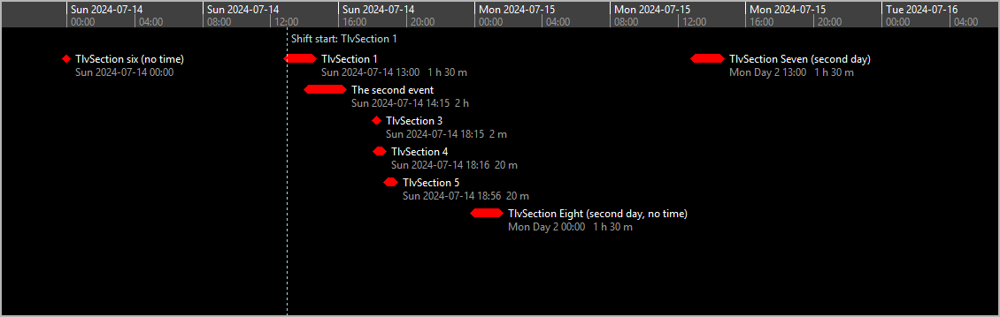
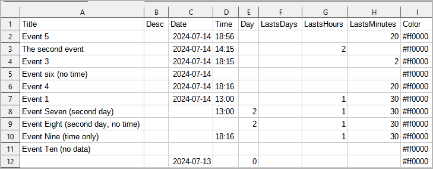

#  timeline-view-tk has moved to [Codeberg](https://codeberg.org/peter88213/timeline-view-tk)

A timeline viewer programmed with Python, using tkinter.

The data is read from a csv file:

*Timeline_viewer* is a simple standalone application using the *tlv* class library 
with a menu and a toolbar. 

## Features

- The application reads the timeline data from a csv file and displays it on a resizable 
  window.
- Events can be defined with a specific date or with an unspecific day.
- For the specific date, the Gregorian calendar is used.
  Only positive dates with years between 0001 and 9999 are accepted.
- For the day zero, you can define a reference date, so that events with unspecific dates 
  can be placed on a calendar scale.  
- You can increase and reduce the time scale. 
- You can scroll forward and back in time.
- You can move the events along the time scale using the mouse.
- You can adjust the events' durations using the mouse.
- The application is ready for internationalization with GNU gettext. 

The *tlv* class library is also used for the 
[novelibre timeline viewer plugin](https://github.com/peter88213/nv_tlview/),
and for the 
[yWriter Timeline viewer](https://github.com/peter88213/yw_tlview)
for example.

---

## Credits

- The logo and the toolbar icons are based on the [Eva Icons](https://akveo.github.io/eva-icons/#/), published under the [MIT License](http://www.opensource.org/licenses/mit-license.php). The original black and white icons were adapted for this application by the maintainer. 

---

## License

This is Open Source software, and *timeline-view-tk* is licensed under GPLv3. See the
[GNU General Public License website](https://www.gnu.org/licenses/gpl-3.0.en.html) for more
details, or consult the [LICENSE](https://github.com/peter88213/timeline-view-tk/blob/main/LICENSE) file.

